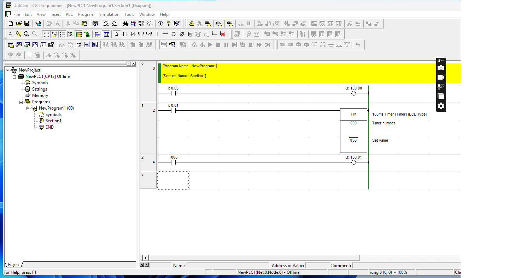
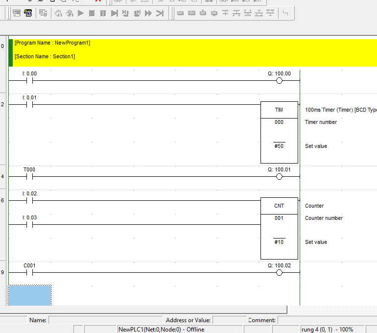
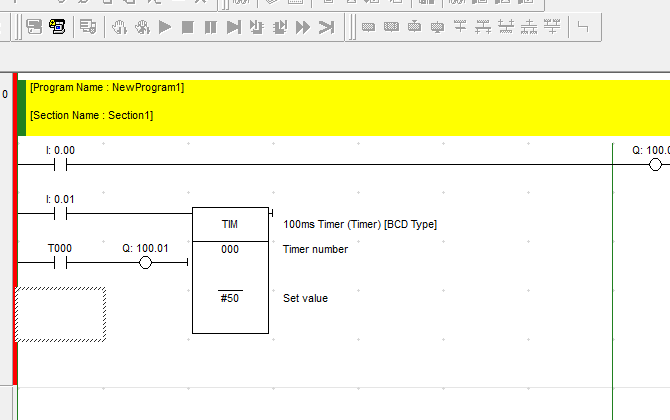
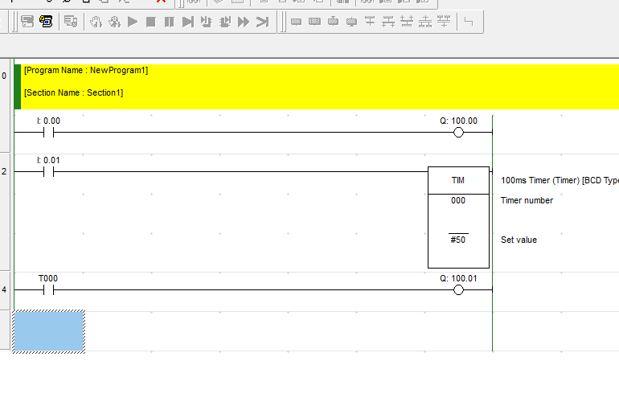
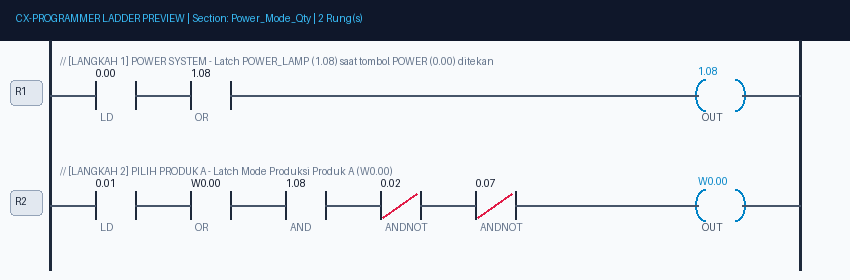

# 🚀 Omron CX-Programmer MCP Server by Ricou

<div align="center">

[](https://github.com/ricolazzami)
[](https://python.org)
[](https://modelcontextprotocol.io)
[](https://ia.omron.com)
[](https://github.com/ricolazzami/Cx-Proggrammer-MCP-by-ricou)
[](LICENSE)

**An intelligent Model Context Protocol (MCP) server by Ricou ([@ricolazzami](https://github.com/ricolazzami)) and automation engine that empowers AI agents to inspect, simulate, visually type, verify, and auto-revise ladder logic directly inside Omron CX-Programmer.**

[Features](#-key-features) • [Visual Showcase](#-visual-showcase) • [Architecture](#-architecture) • [Getting Started](#-getting-started) • [Tools Reference](#-available-mcp-tools) • [Simulation](#-offline-logic-simulation)

---



</div>

---

## 🌟 Key Features

- 👁️ **Visual Error Detection & Auto-Revision:**  
  Real-time image inspection for CX-Programmer's signature red power rail (`R > 180`). If an invalid rung, open branch, or modal popup is detected, the MCP automatically executes live rollbacks (`Ctrl + Z`) and cleans up prompts until the diagram returns to a 100% verified state.
- ⚡ **Zero-Kill / No-Crash Architecture:**  
  Operates without force-closing (`taskkill`) or crashing `CX-P.exe`. Both text `.cxt` and compressed binary `.cxp` formats are kept in twin-sync safely.
- ⌨️ **Live Human-Paced Typing Automation:**  
  Types ladder logic directly into the active CX-Programmer canvas using native keyboard shortcuts (`C` for NO contact, `/` for NC contact, `O` for Coil, `I` for instructions like `TIM` / `CNT`) with visible pacing.
- 🖼️ **Instant Visual Feedback & ACC:**  
  Captures interactive window screenshots and renders standalone 2D ladder PNG previews for instant agent visual confirmation and user sign-off in chat.
- ⏱️ **Offline Scan Cycle Simulation:**  
  Simulate discrete scan cycles, timer delays, and counter accumulation offline without physical PLC hardware.
- 🎯 **Multi-Model Hardware Profiles:**  
  Strict boundary enforcement for **CP1E**, **CP1L**, **CP1H**, **CP2E**, and **CJ2M** architectures (Data Memory `D`, Work bits `W`, Holding bits `H`, Timers `T`, and Counters `C`).

---

## 📸 Visual Showcase

### 1. Live Ladder Construction (Timer & 2-Input Counter)
The MCP types contacts, timers (`TIM`), and 2-input counters (`CNT`) with automatic busbar connection and coil termination:

<div align="center">
  
  <p><em>Verified live ladder diagram: Rung 0 (Direct Coil), Rungs 2 & 4 (ON-Delay Timer), Rungs 6 & 9 (2-Input Pulse & Reset Counter).</em></p>
</div>

### 2. Auto-Healing: Error Detection vs. Auto-Revised Clean State
When an open rung or syntax mismatch occurs, CX-Programmer flags the rung with a red rail. The MCP detects the red pixels and auto-heals the ladder:

<div align="center">
  <table>
    <tr>
      <td align="center"><b>❌ Red Rail Error Detected</b></td>
      <td align="center"><b>✅ Auto-Revised Clean State</b></td>
    </tr>
    <tr>
      <td></td>
      <td></td>
    </tr>
    <tr>
      <td align="center"><em>Open branch / missing connection detected</em></td>
      <td align="center"><em>Auto-rollback via Ctrl+Z, 0 red pixels confirmed</em></td>
    </tr>
  </table>
</div>

### 3. High-Definition Standalone Ladder Preview
For headless environments or quick inspection, the MCP renders standalone clean 2D vector diagrams without opening CX-Programmer:

<div align="center">
  
</div>

---

## 🏗️ Architecture

```mermaid
flowchart TD
    subgraph AI["AI Client / LLM"]
        Agent["Claude / Cursor / Cline / Antigravity"]
    end

    subgraph MCP["Cx-Proggrammer-MCP Server"]
        Router["JSON-RPC Tool Router (server.py)"]
        SafeAPI["SafePlcProject API (api.py)"]
        Engine["AST & Huffman DCL Codec (engine.py / codec.py)"]
        Simulator["Scan Cycle Simulator (simulator.py)"]
        Verifier["Visual Error Verifier (visual_verifier.py)"]
        Typer["Live Typer Engine (live_typer.py)"]
        Renderer["2D Ladder Renderer (ladder_renderer.py)"]
    end

    subgraph Desktop["Windows Desktop & CX-Programmer"]
        Win32["Win32 Desktop Bridge (capture_window.ps1)"]
        CXP["Omron CX-Programmer (CX-P.exe)"]
        TwinFiles[("Twin Project Files (.cxt & .cxp)")]
    end

    Agent <-->|Stdio / MCP| Router
    Router --> SafeAPI
    SafeAPI --> Engine
    SafeAPI --> Simulator
    SafeAPI --> Verifier
    SafeAPI --> Typer
    SafeAPI --> Renderer

    Engine <-->|Read / Safe Twin-Commit| TwinFiles
    Verifier <-->|Cross-Desktop Window Capture| Win32
    Typer <-->|Keyboard Injections (C, /, O, I)| CXP
    Win32 <-->|Desktop Desktop API| CXP
```

---

## 🚀 Getting Started

### Prerequisites
- **Windows OS** (CX-Programmer native platform)
- **Python 3.10+**
- **Omron CX-One / CX-Programmer** installed (for GUI automation & live inspection)

### Installation
```bash
git clone https://github.com/ricolazzami/Cx-Proggrammer-MCP-by-ricou.git
cd Cx-Proggrammer-MCP-by-ricou

# Create and activate virtual environment
python -m venv .venv
.venv\Scripts\activate

# Install dependencies
pip install -r requirements.txt
```

---

## ⚙️ Client Configuration

### Claude Desktop
Add to your `%APPDATA%\Claude\claude_desktop_config.json`:

```json
{
  "mcpServers": {
    "cx-programmer": {
      "command": "C:/Users/ricou/Cx-Proggrammer-MCP/.venv/Scripts/python.exe",
      "args": [
        "C:/Users/ricou/Cx-Proggrammer-MCP/server.py",
        "--project",
        "C:/path/to/project.cxt",
        "--allow-write"
      ]
    }
  }
}
```

### VS Code / Cursor / Roo Code / Cline
Add to your `mcp.json` or Cline MCP settings:

```json
{
  "mcpServers": {
    "cx-programmer": {
      "command": "C:/Users/ricou/Cx-Proggrammer-MCP/.venv/Scripts/python.exe",
      "args": [
        "C:/Users/ricou/Cx-Proggrammer-MCP/server.py",
        "--project",
        "C:/path/to/project.cxt",
        "--allow-write"
      ],
      "disabled": false,
      "autoApprove": []
    }
  }
}
```

---

## 🛠️ Available MCP Tools

| Tool Name | Parameters | Description |
| :--- | :--- | :--- |
| `take_screenshot` | `output_path`, `check_errors` (bool), `auto_revise` (bool) | Captures active CX-P window, checks for red rail errors, and auto-heals diagram if needed. |
| `verify_and_revise` | `output_path`, `auto_revise` (bool) | Dedicated visual auditor: scans ladder for red error rails and rolls back invalid instructions. |
| `live_type_rung` | `instructions` (list), `insert_new_rung` (bool), `typing_speed` (num) | Visually types instructions into CX-Programmer using native hotkeys with human-paced pacing. |
| `project_summary` | `{}` | Summary of PLC model, CPU type, rungs count, sections, and symbols. |
| `get_hardware_profile`| `{}` | Returns architecture limits (Data Memory, Work bits, Timers, Counters). |
| `simulate_scan` | `section`, `inputs`, `scans` | Simulates N discrete scan cycles offline with state transition tracing. |
| `list_sections` | `{}` | Lists all ladder sections with rung counts. |
| `list_rungs` | `section`, `start`, `count`, `mode` | Paginated inspection of rungs within a section. |
| `get_rung` | `section`, `index`, `mode` | Reads a single rung by index with comments and instruction list. |
| `list_symbols` | `scope` ("global" \| "local") | Lists all symbol variables with addresses, data types, and comments. |
| `search_project` | `query`, `section`, `result_type` | Regex search across ladder instructions and variable tables. |
| `validate_project` | `{}` | Programmatic AST validation: checks branch balance, stack depth, and memory boundaries. |
| `commit_project` | `backup` (bool) | Atomically validates and commits twin `.cxt` and `.cxp` files without killing CX-P. |
| `create_project` | `target_path`, `template` | Spawns a clean project pair from validated CP1E/CP1H/CP2E/CJ2M base templates. |
| `open_in_cxp` | `{}` | Opens active project safely in CX-Programmer GUI. |

---

## 🧪 Offline Logic Simulation

Engineers can test logic before writing to disk or commissioning hardware:

```python
from api import SafePlcProject

project = SafePlcProject("project/Conveyor_Control.cxt")

# Simulate 3 scan cycles with Sensor active on scan 1
traces = project.simulate_scan(
    section="ConveyorSection",
    inputs={"SENSOR_1": True, "ESTOP": False},
    scans=3
)

for trace in traces:
    print(f"Scan #{trace['scan']}: Output Changes = {trace['changes']}")
```

---

## 📊 Supported Omron Hardware Profiles

| Family | Models | Data Memory (D) | Work Area (W) | Holding Area (H) | Timers & Counters | Binary Timers (TIMX/CNTX) |
| :--- | :--- | :--- | :--- | :--- | :--- | :---: |
| **CP1E** | `E20`, `N30`, `NA20` | D0 - D7999 | W0.00 - W99.15 | H0.00 - H49.15 | 256 (`T0-255`, `C0-255`) | ❌ (BCD Only) |
| **CP1L** | `L10`, `L20`, `M30`, `M40` | D0 - D32767 | W0.00 - W511.15 | H0.00 - H511.15 | 4096 (`T0-4095`, `C0-4095`) | ✅ Supported |
| **CP1H** | `X40`, `XA40` | D0 - D32767 | W0.00 - W511.15 | H0.00 - H511.15 | 4096 (`T0-4095`, `C0-4095`) | ✅ Supported |
| **CP2E** | `E`, `S`, `N30` | D0 - D32767 | W0.00 - W511.15 | H0.00 - H1535.15 | 4096 (`T0-4095`, `C0-4095`) | ✅ Supported |
| **CJ2M** | `CPU1x`, `CPU31` | D0 - D32767 | W0.00 - W511.15 | H0.00 - H511.15 | 4096 (`T0-4095`, `C0-4095`) | ✅ Supported |

---

## 🤝 Contributing & License

Contributions, issues, and feature requests are welcome!

- **Author & Lead Maintainer:** **Ricou** ([Rico Allif Lazzami](https://github.com/ricolazzami))
- **Base Foundation:** [BlackUppsss/Cx-Proggrammer-MCP](https://github.com/BlackUppsss/Cx-Proggrammer-MCP)
- **License:** MIT License. See [LICENSE](LICENSE) for details.
